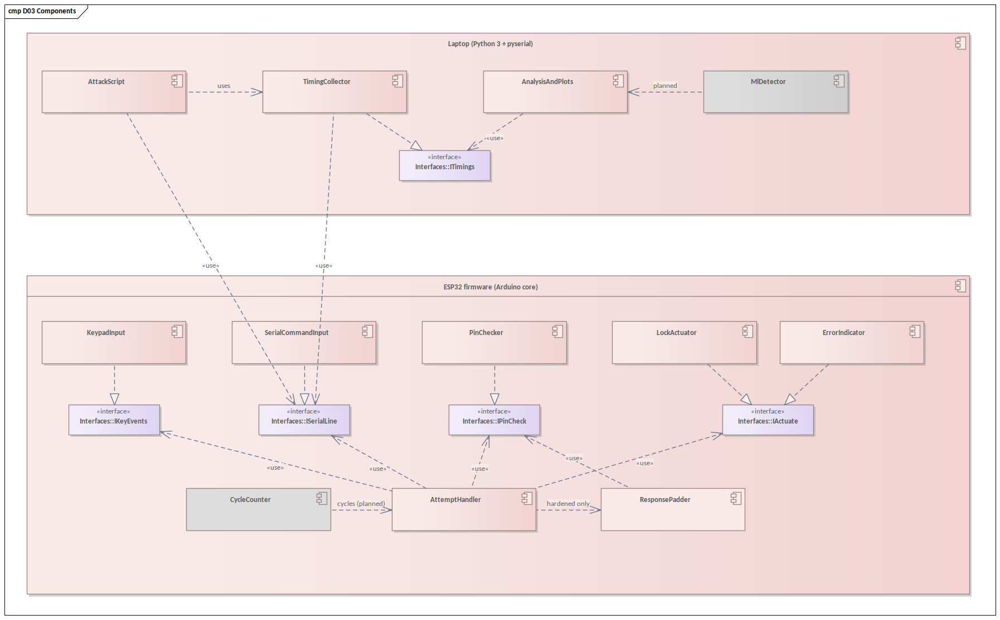
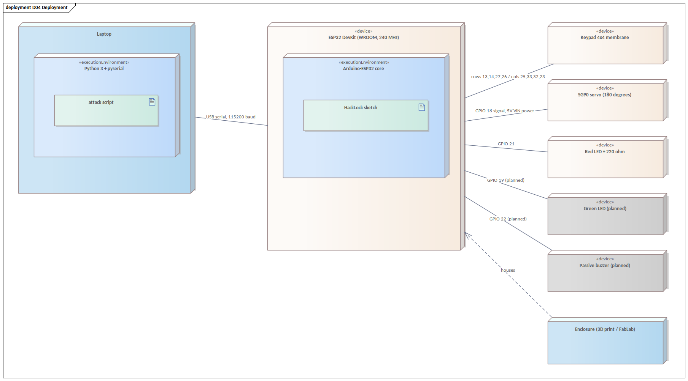
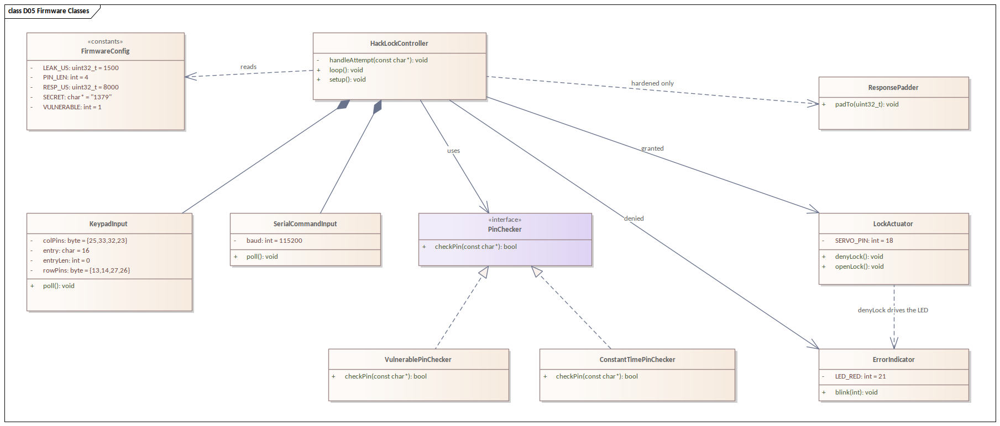
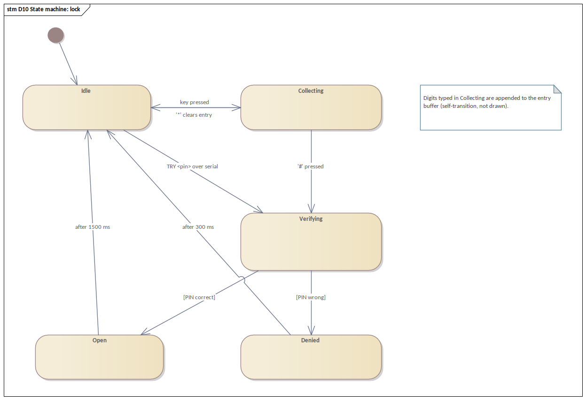
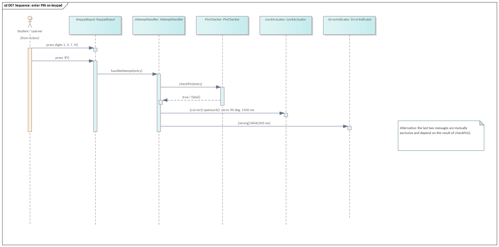
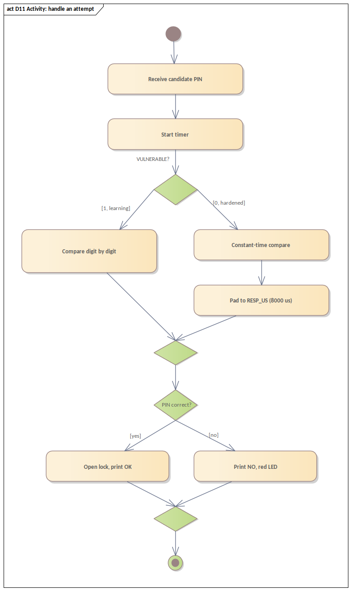
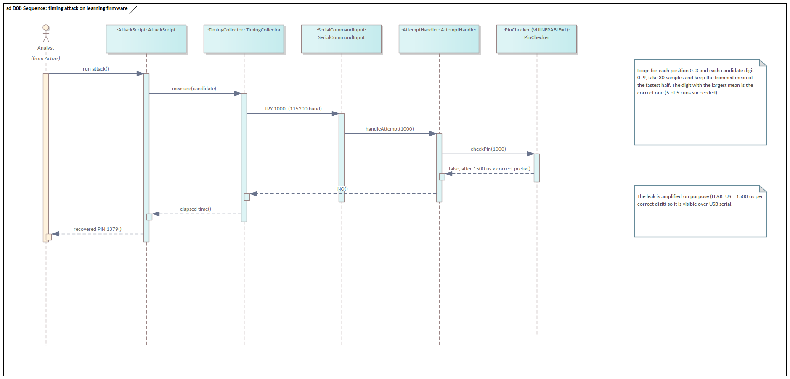
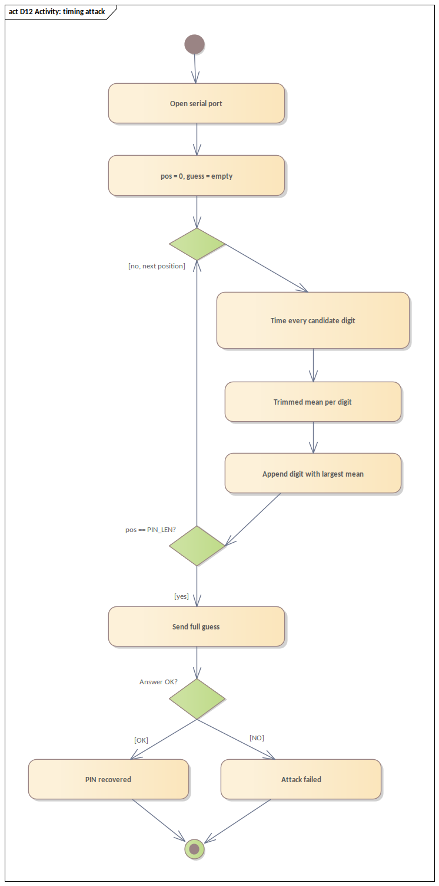
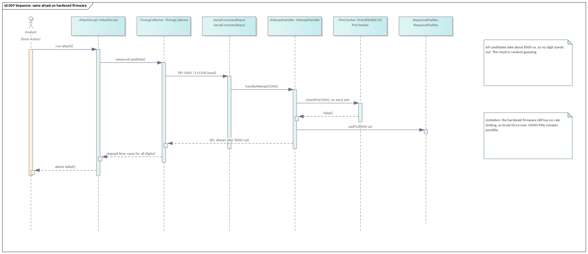

---
# 🧩 Versioning – systém dopĺňa automaticky
fm_version: "1.0.1"

# Dátum buildu – generuje skript
fm_build: "2026-10-26T08:23:37.315264+00:00"

# Poznámka k verzii – voliteľné
fm_version_comment: ""

# 🆔 IDENTITY --------------------------------------------------------

# ID generuje CLI / skript

# Unikátne UUID – generuje skript
guid: "fc6837a0-5c2c-4cfa-bfb8-47b5d57f4d73"

# 🧭 CONTEXT ---------------------------------------------------------

# DAO / doména (knife, sdlc, q12, 7ds...) dopĺňa skript
dao: "sthdf"

# Názov zápisu – dopĺňa používateľ
title: "architecture diagram"

# Krátky popis – dopĺňa používateľ (voliteľné)
description: "Architektúra HackLock: komponenty, nasadenie, triedy firmvéru a správanie systému"

# 👥 AUTHORSHIP ------------------------------------------------------

# Hlavný autor – z globálneho configu
author: "Roman Kazicka"

# Zoznam autorov – generuje skript
authors:
  - "Roman Kazicka"

# 🗂 CLASSIFICATION ---------------------------------------------------

# Nadradená kategória – môže doplniť používateľ
category: ""

# Typ dokumentu (guide, case, tutorial...) – používateľ (voliteľné)
type: ""

# Priorita (low/medium/high) – voliteľné
priority: ""

# Tagy – odporúča sa 2–6 tagov.
# Typy tagov:
#   - rámce: knife, 7ds, sdlc, q12
#   - účel: tutorial, guide, pattern, case-study
#   - téma: git, backup, ai, communication
#   - úroveň: beginner, intermediate, advanced
tags: []

# 🌍 LOCALIZATION -----------------------------------------------------

# Jazyk dokumentu – doplní skript podľa štruktúry
locale: "sk"

# 🕒 LIFECYCLE --------------------------------------------------------

# Dátum vytvorenia – generuje skript
created: "2026-10-26 09:23"

# Dátum poslednej úpravy – dopĺňa človek
modified: "2026-10-26 09:23"

# Stav dokumentu – default "backlog"
status: "backlog"

# Viditeľnosť – default "public"
privacy: "public"

# ⚖ INTELLECTUAL PROPERTY -------------------------------------------

# Držiteľ práv k obsahu – dopĺňa skript
rights_holder_content: "Roman Kazicka"

# Systémový vlastník práv
rights_holder_system: "CAA / KNIFE / LetItGrow"

# Licencia
license: "CC-BY-NC-SA-4.0"

# Disclaimer
disclaimer: "Use at your own risk. Methods provided as-is; participation is voluntary and context-aware."

# Copyright
copyright: "© 2025 Roman Kazicka"

# 🔗 ORIGIN / PROVENANCE ---------------------------------------------

# Repozitár pôvodu
origin_repo: ""

# URL pôvodného repozitára
origin_repo_url: ""

# Commit pôvodu
origin_commit: ""

# Branch pôvodu
origin_branch: ""

# Systém pôvodu (CAA/KNIFE/STHDF…)
origin_system: "CAA"

# Pôvodný autor
origin_author: "Roman Kazicka"

# Importovaný zdroj
origin_imported_from: ""

# Dátum importu
origin_import_date: ""

# 🧱 RESERVED ---------------------------------------------------------

fm_reserved1: ""
fm_reserved2: ""
---

<!-- SDLC_INSTANCE_ID: PRJ-711-HackLock -->

# 🏗️ Architecture Diagram

Architektúra HackLock zo vzoru Enterprise Architect. Systém tvorí firmvér na ESP32 a pomocný nástroj na notebooku, ktorý cez sériovú linku meria čas odozvy.

## Komponenty
Notebook (Python 3 + pyserial) obsahuje `AttackScript`, `TimingCollector` a `AnalysisAndPlots`. Firmvér na ESP32 má komponenty `KeypadInput`, `SerialCommandInput`, `PinChecker`, `LockActuator`, `ErrorIndicator` a `AttemptHandler`. `ResponsePadder` sa používa len v zabezpečenej verzii. `MlDetector` a `CycleCounter` sú zatiaľ len plánované.

## Nasadenie a zapojenie
Notebook komunikuje s ESP32 DevKit cez USB sériovú linku (115200 baud). K ESP32 je pripojená klávesnica 4x4, servo SG90 (GPIO 18) a červená LED (GPIO 21). Zelená LED, bzučiak a kryt (3D tlač / FabLab) sú zatiaľ plánované alebo vo výrobe.

## Triedy firmvéru
`HackLockController` používa rozhranie `PinChecker`, ktoré implementujú `VulnerablePinChecker` (učebná verzia) a `ConstantTimePinChecker` (zabezpečená verzia).

## Správanie
### Stavový automat zámku

### Zadanie PIN na klávesnici

### Spracovanie pokusu

### Útok na slabý (učebný) firmvér

### Rovnaký útok na zabezpečený firmvér

---
**Navigation:** [⬆️ Up](./index.md) · [🏠 Home](../index.md)
