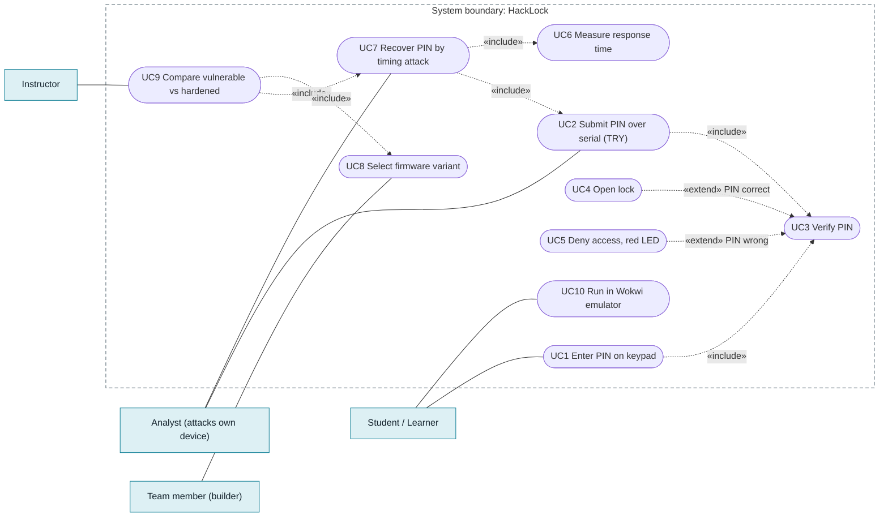
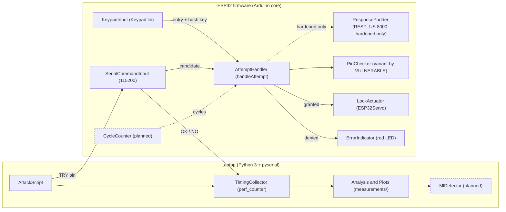
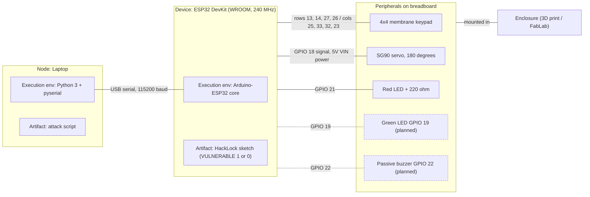
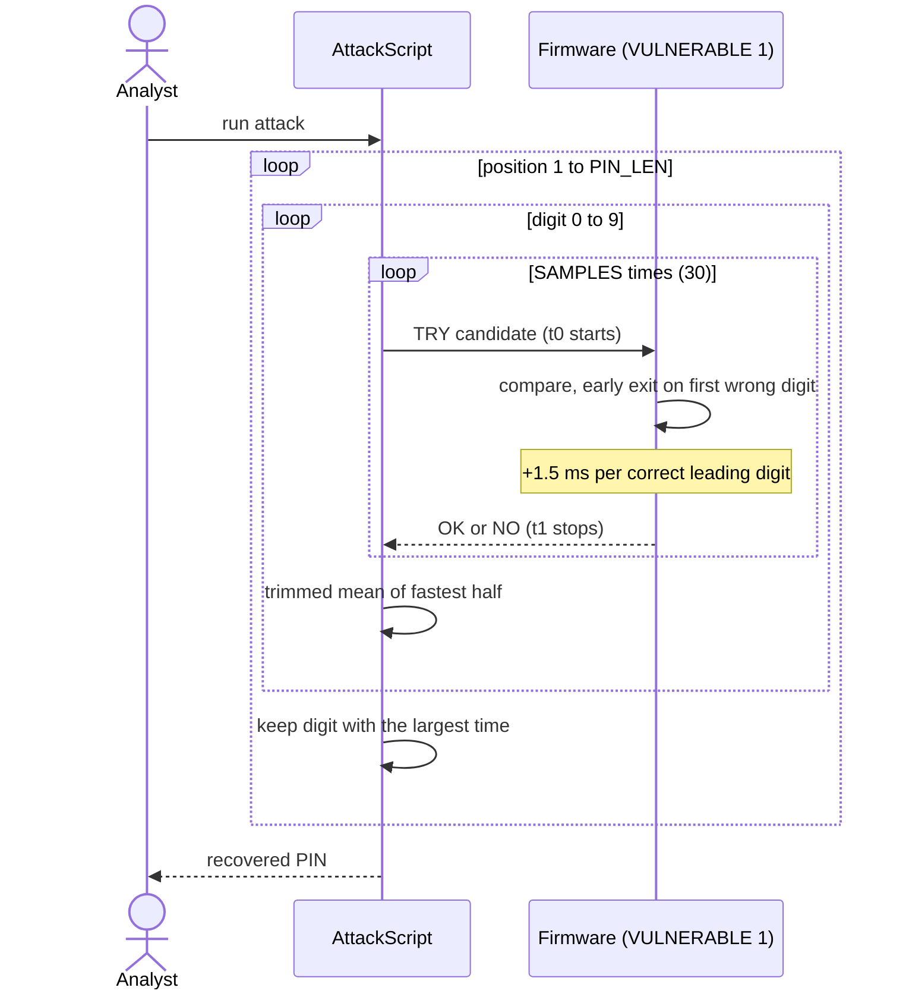
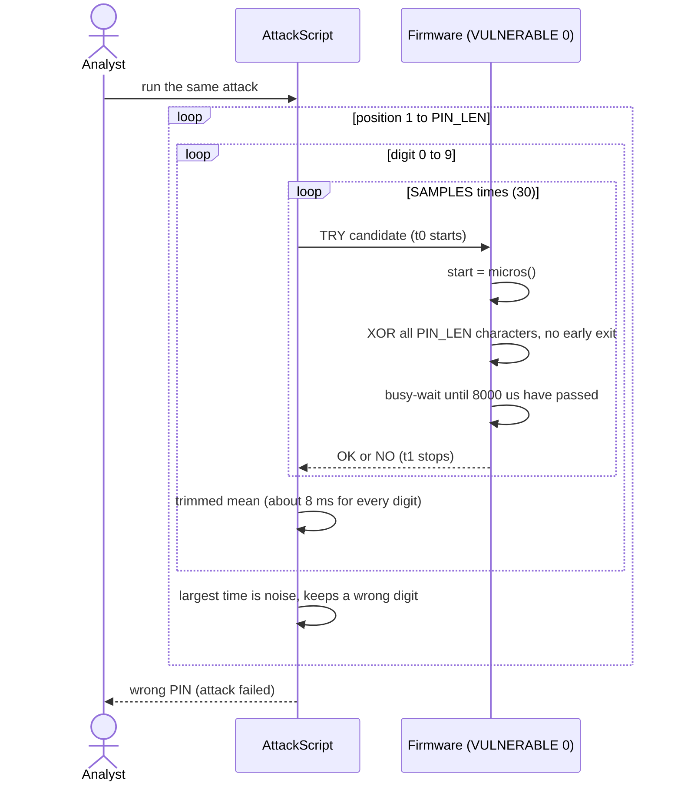
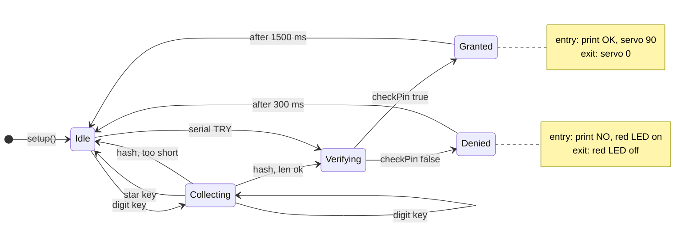

# HackLock diagrams

UML views of the HackLock design, derived from the firmware sketch (`tools/emulator`) and the project description. GitHub renders the diagrams below directly from the Mermaid source. They are a working version; a full Enterprise Architect model will replace or extend them.

| # | Diagram |
|---|---------|
| 1 | [Use cases](#use-cases) |
| 2 | [Components](#components) |
| 3 | [Deployment and wiring](#deployment-and-wiring) |
| 4 | [Sequence: timing attack on the learning (vulnerable) firmware](#sequence-timing-attack-on-the-learning-vulnerable-firmware) |
| 5 | [Sequence: the same attack on the hardened firmware](#sequence-the-same-attack-on-the-hardened-firmware) |
| 6 | [State machine of the lock](#state-machine-of-the-lock) |

## Use cases

Who interacts with HackLock and what they can do. `Verify PIN` is shared by the keypad and serial paths; opening the lock and denying access extend it.

## Components

Two sides: the laptop with the timing-attack tooling, and the ESP32 firmware. The only external interface between them is the serial line (`TRY <pin>` / `OK` or `NO`). Dashed elements are planned.

## Deployment and wiring

Physical nodes and GPIO pins. Dashed elements are planned (green LED, buzzer).

## Sequence: timing attack on the learning (vulnerable) firmware

Each correct leading digit adds about 1.5 ms to the response, so the digit with the largest time is the correct one.

## Sequence: the same attack on the hardened firmware

Same script and protocol. The constant-time comparison and the fixed 8 ms response remove the signal, so the attack recovers noise.

## State machine of the lock

Current firmware behaviour. `delay()` blocks the main loop in `Granted` and `Denied`.

---

*Planned* parts (green LED, buzzer, cycle-counter mode, ML detector) are drawn dashed because they are not in the code yet.
